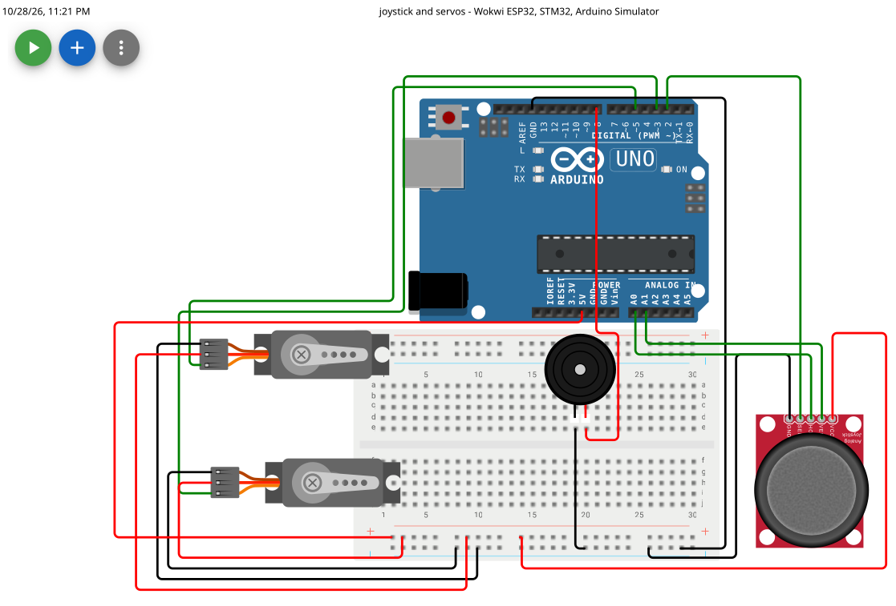

# Joystick et servomoteurs (Arduino Uno)

Deux servomoteurs qui suivent la position d'un joystick analogique, avec un buzzer
qui bipe quand le joystick s'écarte du centre. Projet simulé sur Wokwi et compilé avec PlatformIO.



▶️ **[Essayer la simulation sur Wokwi](https://wokwi.com/projects/474636291722579969)**

## Fonctionnalités
- L'axe horizontal du joystick pilote le servo 1, l'axe vertical pilote le servo 2
  (chaque servo suit directement la position du joystick, de 0° à 180°)
- Le buzzer émet un bip quand le joystick s'écarte du centre de plus de `marge` (50)
- Les valeurs des axes sont affichées sur le moniteur série (9600 bauds)

## Matériel
| Composant | Quantité | Broche Arduino |
|---|---|---|
| Arduino Uno | 1 | - |
| Joystick analogique | 1 | VRx → A0, VRy → A1, SEL → 2, VCC → 5V, GND → GND |
| Servomoteur | 2 | signal → 5 (servo 1) et 3 (servo 2) |
| Buzzer | 1 | 8 |

## Comment ça marche
1. `analogRead` lit chaque axe : une valeur de 0 à 1023 (environ 512 au repos).
2. `map` convertit cette valeur en angle de 0° à 180°, envoyé au servo avec `write`.
3. Si l'écart au centre dépasse `marge` sur l'un des deux axes, `tone` fait sonner le buzzer 50 ms.
4. Une pause de 200 ms sépare chaque mesure.

## Structure du dépôt
```
├── src/main.cpp      # le programme
├── platformio.ini    # configuration PlatformIO (carte Arduino Uno)
├── diagram.json      # le circuit Wokwi
├── wokwi.toml        # configuration de la simulation Wokwi
└── images/           # capture du circuit
```

## Lancer le projet

**Le plus rapide : en ligne**
1. Ouvre le [lien Wokwi](https://wokwi.com/projects/474636291722579969) et clique sur le bouton de simulation(BOUTON VERT)
2. Déplace le joystick avec la souris et observe les servos

**En local avec PlatformIO (VS Code)**
1. Clone le dépôt : `git clone https://github.com/Charbel1313/joysticks-servos.git`
2. Ouvre le dossier dans VS Code avec l'extension PlatformIO
3. Compile : `pio run`
4. Pour simuler en local, il faut en plus l'extension Wokwi pour VS Code
   (voir sa documentation pour l'activation). Le dossier `.pio/` n'est pas dans le dépôt :
   la compilation de l'étape 3 le crée.

## Sur du vrai matériel
Alimente les servos avec une source externe : le 5V de l'Arduino peut ne pas
suffire pour deux servos et provoquer des redémarrages de la carte.

## Ce que j'ai appris
- Lecture analogique (`analogRead`) et conversion de plage (`map`)
- Contrôle de servomoteurs avec la bibliothèque `Servo`
- Génération de sons avec `tone`
- Résistance de rappel interne (`INPUT_PULLUP`)
- Organiser un projet PlatformIO et le publier sur GitHub

## Pistes d'amélioration
- Utiliser le bouton SEL du joystick (par exemple pour recentrer les servos ou couper le buzzer)
- Ajouter une zone morte pour les servos (aujourd'hui `marge` n'agit que sur le buzzer)
- Remplacer `delay()` par `millis()` pour une réaction plus fluide

## Licence
MIT